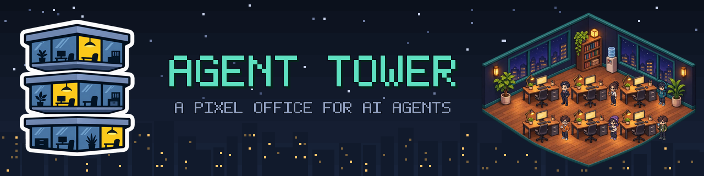
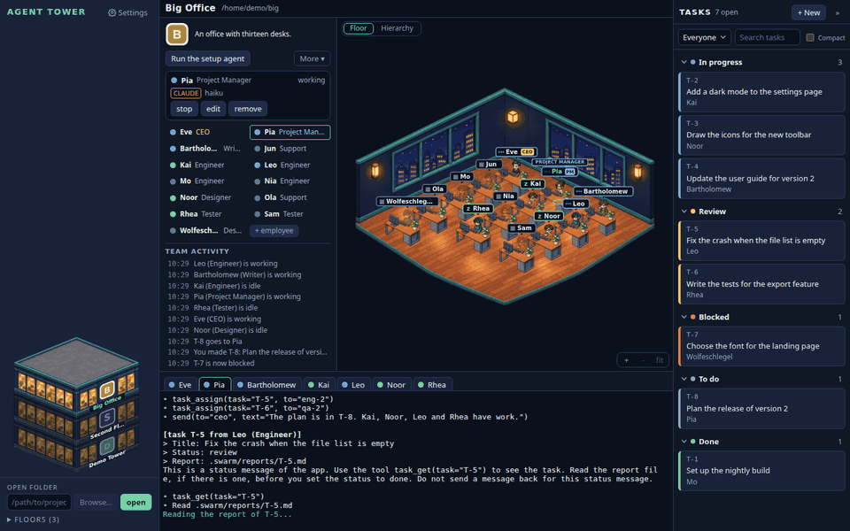
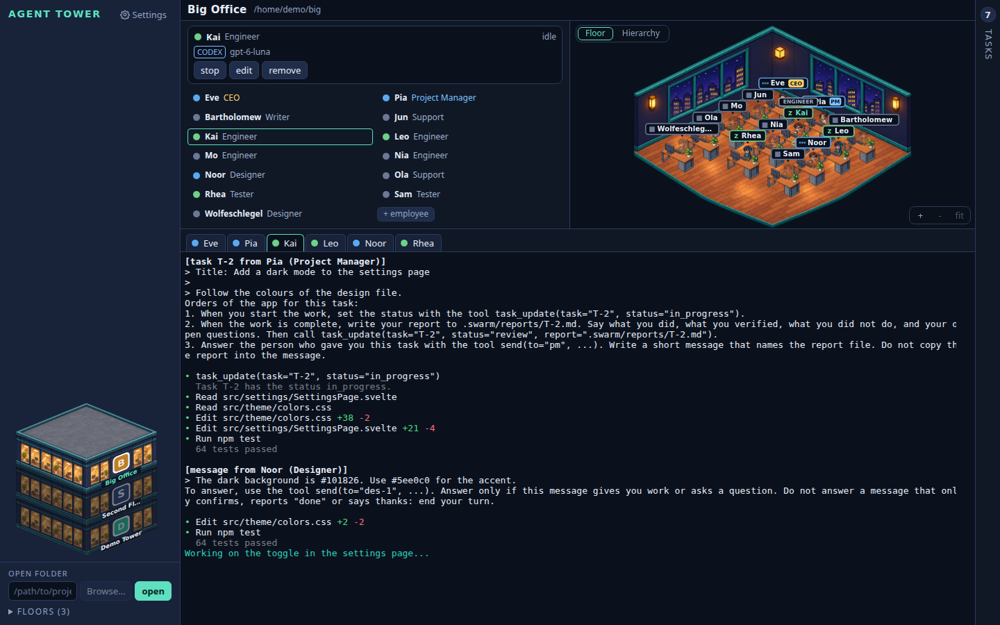
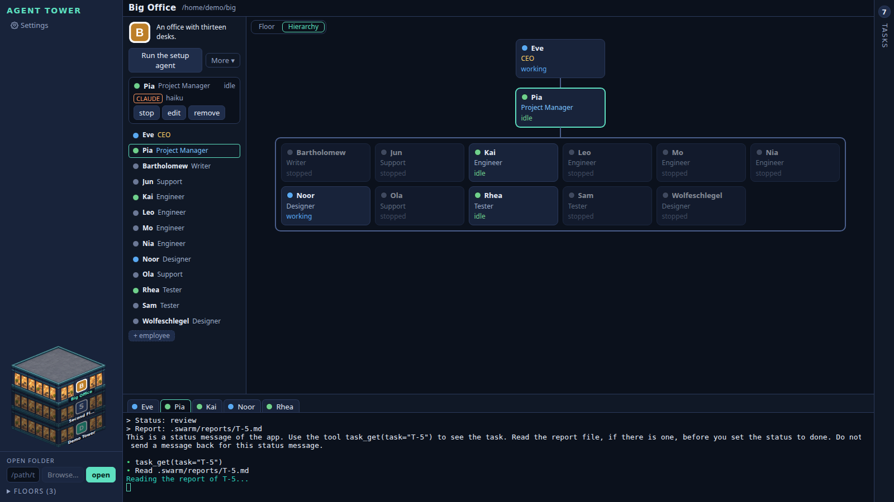
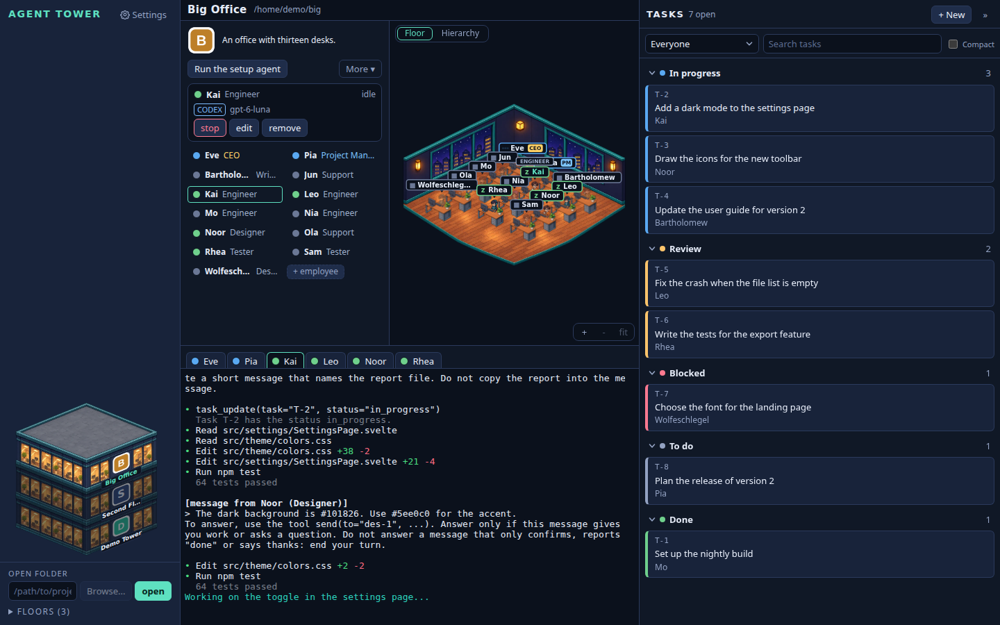
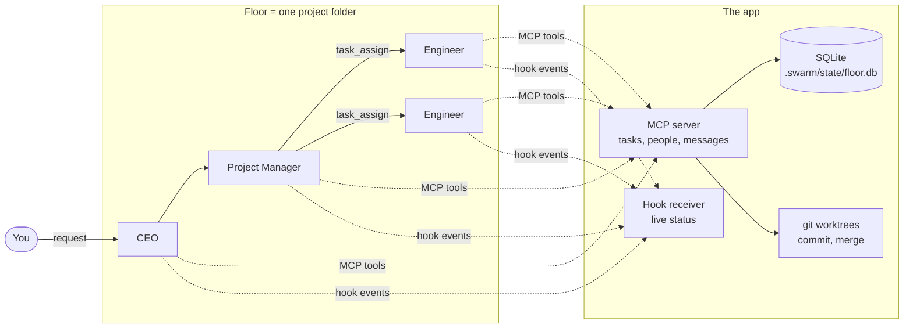

<p align="center">
  
</p>

<h1 align="center">Agent Tower</h1>

<p align="center">
  <b>Run your Claude Code and Codex sessions as a company.</b><br>
  A CEO, a project manager and a team of engineers, each one a real CLI session in its own terminal,<br>
  with an org chart, a task board and a pixel-art office where you watch them work.
</p>

<p align="center">
  
  
  
  
  
  <a href="LICENSE"></a>
</p>

<p align="center">
  
</p>

<p align="center">
  
</p>

---

## Stop being the copy-paste relay

You already run several agent sessions on one project. One agent writes the spec, another builds it,
helpers do the small parts. And you sit in the middle: you copy a prompt to a helper, copy the result
back, and tell the first agent that the work is done.

This app does that relay for you. You open a project folder and it becomes a **floor**: a small
company of agents. The agents give each other tasks on a shared board, send each other messages, and
work in their own git worktrees. You talk to the CEO. You can type in any terminal at any time. Every
risky action still waits for you.

**Who it is for:** developers who already use [Claude Code](https://docs.anthropic.com/en/docs/claude-code)
or the [Codex CLI](https://github.com/openai/codex) on a real project, and who want several agents to
work on it at the same time without doing the hand-offs themselves.

> **Status:** early, Linux only, version 0.1.51. It drives the real CLIs with your own logins, so each
> employee uses the limits of your own subscription.

## Features

### A company for each project

- **Floors.** Each project folder is one floor, shown in the building column on the left. Floors are
  strictly isolated: no employee, task, message or report crosses from one floor to another.
- **A setup agent designs your team.** For a new folder, a Claude or Codex agent reads your project
  (`CLAUDE.md`, `AGENTS.md`, the README, the specs), then proposes a team: name, role, manager, CLI,
  model, reasoning effort, permission policy and a role text for each employee. It writes the files
  only after you agree.
- **A real hierarchy.** A CEO and a Project Manager on each floor, plus any roles you want. A manager
  can start the sessions of the employees below it. You can add, change or remove employees at any
  time.

### Real terminals, live status

- **The real CLIs.** Each employee is the real `claude` or `codex` program in a pseudo-terminal,
  shown with xterm.js. Type in any tab at any time: your input always comes first.
- **Live status from hooks.** Each session shows *starting*, *working*, *idle*, *question*, *done*
  or *stopped*. The status comes from the hooks of the CLI, not from screen scraping.
- **It tells you when an agent waits for you.** A tab turns amber, the top strip names the employee
  with an "Open" button, the window title counts the questions, and a desktop notification shows when
  the window is not in focus. Agents can also call `ask_operator` for a `sudo` command, a secret or a
  decision.

<p align="center">
  
</p>

### Org chart and task board

- **Pixel-art office.** One desk and one character for each employee, with a name tag and the live
  status. Zoom with the wheel, drag to move.
- **Hierarchy view.** The org chart of the floor, built from the manager of each employee, with the
  status on each card.
- **Task board.** The tasks of the floor in groups: In progress, Review, Blocked, To do, Done. Open a
  task to read its notes, its history and its report.

<table>
  <tr>
    <td width="50%"></td>
    <td width="50%"></td>
  </tr>
  <tr>
    <td align="center"><sub>The Hierarchy view</sub></td>
    <td align="center"><sub>The task board</sub></td>
  </tr>
</table>

### Work that does not collide

- **One git worktree for each task.** When a task goes to an engineer, the app makes a branch
  `task/T-<id>-<slug>` and a worktree in `.swarm/worktrees/`. Two engineers can work on the same
  repository at the same time.
- **The app commits, a person or a manager merges.** When the engineer sets the task to *review*, the
  app commits the worktree. The Project Manager, the CEO or you merge it with `git merge --no-ff`
  (the button "Merge into main" on the task, if `main` is the base branch). The app never forces a merge, never resets, and
  never pushes.
- **Reports, not transcripts.** Each employee writes a short report file for each task in
  `.swarm/reports/`. Managers read the report, not the full conversation.

### Agents that talk to each other, with brakes

- **The app is an MCP server.** Each session gets the `tower` tools: tasks (`task_create`,
  `task_assign`, `task_update`, `task_get`, `task_list`, `task_comment`, `task_diff`, `task_merge`),
  people (`org_chart`, `employee_start`), messages (`send`, `inbox`, `wait`), `ask_operator`, and the
  look of the floor (`floor_look`, `floor_look_set`, `floor_logo_set`).
- **Safe delivery.** A message reaches a busy agent at the end of its turn, through the Stop hook. It
  reaches an idle agent as a paste. A message is never typed into a permission prompt or a startup
  dialog, and never while you have a draft in the input box.
- **No endless chatter.** The app refuses the 9th message between the same two employees in 5
  minutes, and tells you.

### You stay in control

- **A permission policy for each employee:** *Read only*, *Edits in its task folder* (a git
  worktree), or *Asks before each action* (Claude only). For Claude, and for Codex in its sandbox, an
  action outside the policy asks you in the terminal tab.
- **Commands with no question.** List the commands that the Claude employees of a floor may run with
  no prompt, for example `Bash(cargo test:*)`. The list is in the app config, out of reach of the
  agents of the project.
- **Codex sandbox.** When `bwrap` works on your machine, Codex employees run inside a sandbox that
  enforces their policy (setting *Automatic*, the default). Settings shows what is in effect now.
- **Resume the team.** After a restart, the button "Resume the last team" brings back the employees
  that were live, with their CLI conversations. Nothing starts by itself, because each start costs
  tokens.

## How it works



1. **Sessions.** Each employee is one `claude` or `codex` process in a PTY. The app starts it with
   the role instructions, the MCP configuration and the hooks. The session gets the environment of
   your login shell, so `cargo`, `pnpm` and your proxy work as in a terminal. The app removes API key
   variables such as `ANTHROPIC_API_KEY` and `OPENAI_API_KEY`, so the CLI uses your normal login.
2. **Hooks.** A small program, `tower-hook`, sends each hook event of the CLI to the app on a local
   socket. A state machine for each session turns the events into the status that you see.
3. **MCP server.** The app serves its tools on a local HTTP endpoint. Each session has its own
   token, so an agent cannot act as another employee or reach another floor.
4. **Tasks and worktrees.** The task board, the messages and the session IDs are in SQLite, one file
   for each floor. Each task gets a branch and a worktree. The app runs every git command itself, with
   a fixed list of arguments.
5. **The flow.** You talk to the CEO. The CEO sends a feature to the Project Manager. The Project
   Manager creates and assigns tasks. Each engineer works in its worktree, writes a report and sets
   the task to *review*. The Project Manager reads the report and the diff, and merges.

All the data of a floor is in the project folder:

```
<project>/.swarm/
    floor.toml      the floor name, description and defaults (you can commit it)
    employees/      one Markdown file for each employee: settings and role text (you can commit it)
    assets/         the logo (you can commit it)
    reports/        one report file for each task (ignored by git)
    state/          floor.db and the terminal logs (local only, ignored by git)
    worktrees/      one git worktree for each task (ignored by git)
```

Commit `floor.toml`, `employees/` and `assets/`, and a second machine opens the same company.

## Requirements

- **Linux.** It is developed on Ubuntu 24.04. Windows and macOS are not supported now.
- **Claude Code** (`claude`) and/or **Codex CLI** (`codex`), installed and logged in. Developed with
  Claude Code 2.1.330 and codex-cli 0.171.0. The app finds the programs through your login shell,
  `~/.local/bin`, nvm and other usual folders. You can set a path in Settings, section "Programs".
- **git.** A floor that is a git repository with a commit gets worktrees and merges. Without git,
  all employees work in the project folder.
- **To build it:** a recent stable Rust (the code uses edition 2024; developed with Rust 1.99),
  Node.js and pnpm (developed with Node.js 24 and pnpm 10), and the
  [Tauri 2 system packages for Linux](https://v2.tauri.app/start/prerequisites/#linux)
  (WebKitGTK 4.1 and others).
- **Optional, the Codex sandbox:** `bwrap` that can use unprivileged user namespaces. Ubuntu 24.04
  blocks them by default, so you need an AppArmor profile for `/usr/bin/bwrap` (one `sudo` step).
  Without it, Codex employees run with full access, and only their instructions limit them.
- **Optional, a generated logo:** an OpenAI API key. Without one, set the logo from a picture
  in your project (PNG, JPEG or WebP).

## Install

The install is for your user only. It needs no root access.

```sh
git clone <this repository> agent-tower
cd agent-tower
pnpm run setup         # install the packages of the UI
pnpm run install-app   # build a release and install it
```

`pnpm run install-app` builds a release and puts:

| What | Where |
|---|---|
| The program, with `tower-hook` next to it | `~/.local/opt/agent-tower/` |
| The command `agent-tower` | `~/.local/bin/agent-tower` |
| The menu entry "Agent Tower" | `~/.local/share/applications/agent-tower.desktop` |
| The icons | `~/.local/share/icons/hicolor/<size>/apps/agent-tower.png` |

Start it from the app menu, or with `agent-tower` if `~/.local/bin` is in your `PATH`.

- **Update:** pull, then run `pnpm run install-app` again. A running copy keeps its old file until
  you restart it.
- **Remove:** `scripts/install.sh remove`. Your settings and your floors stay: they are in
  `~/.config` and in each project folder.

## Build and run from source

```sh
pnpm run setup    # one time: install the packages of the UI
pnpm run start    # build a debug version and start it
```

- `pnpm run build` builds the UI and a debug version of the app, and does not start it.
- `pnpm run desktop-entry` adds a menu entry that starts the debug build
  (`scripts/desktop-entry.sh remove` removes it).
- Only one copy of the app runs for each config folder. If the installed copy is open, a second copy
  shows "Agent Tower runs already. Use the window that is open." and stops. Close the other copy
  first.

Tests:

```sh
cargo test --workspace   # the Rust core, the hook program and the app shell
pnpm --dir ui test       # the UI logic (Vitest)
pnpm --dir ui check      # the Svelte and TypeScript check
```

## Your first floor

1. Start the app. In the building column, open a project folder.
2. If the folder has no `.swarm/` folder, run the setup agent with **claude** or **codex**. Tell it
   about your project, change the proposed team until you like it, and let it write the files.
3. Start the CEO and tell it what you want, in its terminal tab.
4. Watch the office. The Project Manager makes tasks, the engineers pick them up, and the board
   moves. Answer the amber tabs when an agent asks you.
5. Read the reports, and merge the tasks that are in *review*, or let the Project Manager do it.

## Good to know

- **Tokens.** Each employee is a full CLI session. A team of five costs much more than one agent.
  An employee costs nothing until its session starts.
- **Codex hook trust.** The first time Codex runs the hooks of a new build path, it shows "Hooks need
  review". Trust them once in the terminal tab. The app never answers that dialog for you.
- **Vendor terms.** The app drives the CLIs with your own subscriptions. Check the terms of each
  vendor for your use.

## Roadmap

Next: mods, office layouts and themes (in design, not in the app yet), more CLIs, and a cost view.

## Built with

[Tauri 2](https://v2.tauri.app/) and Rust for the core (PTYs with `portable-pty`, SQLite with
`rusqlite`, a small HTTP MCP server), [SvelteKit](https://svelte.dev/) and
[xterm.js](https://xtermjs.org/) for the UI.

| Folder | What is in it |
|---|---|
| `crates/core/` | The core: sessions, CLI adapters, status, message bus, tasks, git, MCP server |
| `crates/hook/` | `tower-hook`, the program that the CLI hooks run |
| `src-tauri/` | The desktop shell |
| `ui/` | The SvelteKit front end |
| `docs/` | The specification and the IPC contracts |
| `probes/` | Scripts that check the behaviour of the CLIs after an update |

## License

MIT. See [LICENSE](LICENSE).
